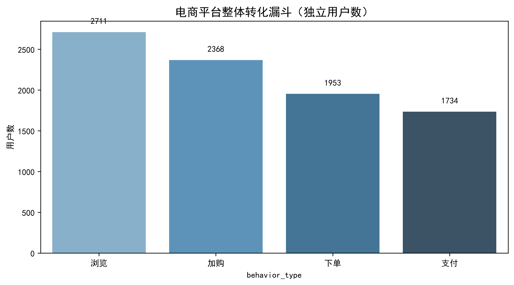
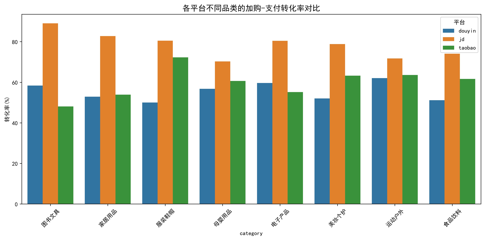
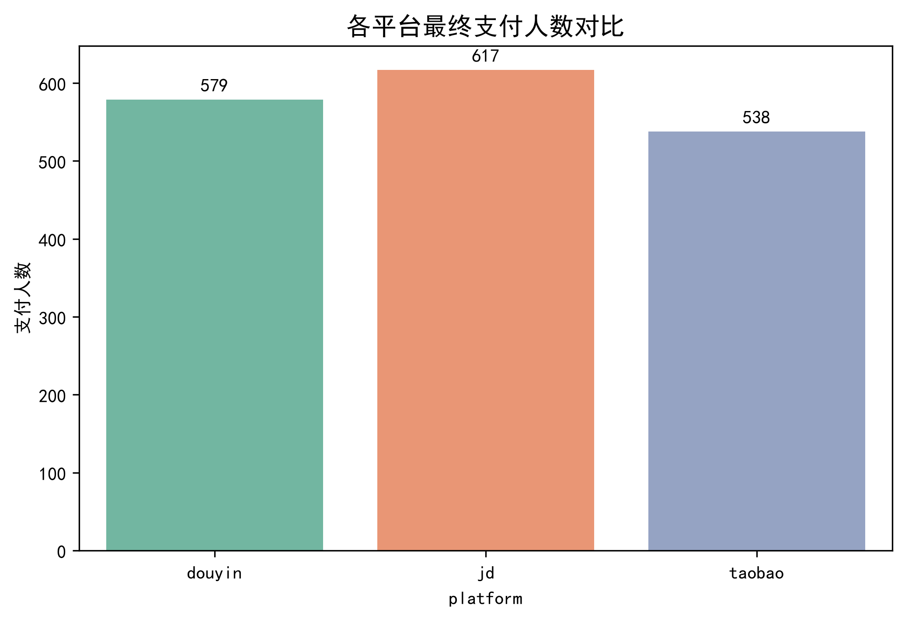

📊 多平台电商用户行为与转化漏斗分析报告
分析师： 黄岳
日 期： 2026年10月
数据来源： 阿里云天池 - 多平台电商运营分析数据集
________________________________________
一、 项目背景与目标
随着电商行业流量红利见顶，提升现有用户的转化效率成为平台运营的核心。本项目基于淘宝、京东、抖音三大主流电商平台约 2.2 万条脱敏的真实用户行为数据，旨在通过构建用户行为漏斗，定位用户流失的核心环节，并找出导致流失的具体平台与商品品类，最终为业务团队提供数据驱动的运营优化建议。
二、 数据概况与处理
•	数据规模： user_behavior（行为流水表）共 21,998 行，涵盖浏览、加购、收藏、下单、支付等 7 种核心行为；product（商品维表）提供品类归属信息。
•	数据清洗：
1.	剔除了全空的 app_version 字段及与业务分析无关的字段（如 extra_data 等）。
2.	过滤了非核心转化路径的行为（如分享、评价），聚焦“浏览 → 加购 → 下单 → 支付”的主链路。
3.	使用 global_product_id 作为主键，将行为表与商品表进行 LEFT JOIN，构建包含“用户ID、平台、行为类型、商品品类”的分析宽表。
•	核心指标定义：
o	独立用户数（DAU）：使用 nunique() 对 global_user_id 去重统计，避免同一用户多次行为带来的数据虚高。
o	加购-支付转化率 = 支付独立用户数 / 加购独立用户数 × 100%。
三、 核心数据分析过程与发现
3.1 宏观漏斗：加购到支付流失严重
通过对全量用户构建转化漏斗（见下图），我们发现：
从“浏览”到“加购”，用户的意向筛选极为明显；但核心痛点出现在“加购 → 支付”环节，大量用户将商品加入购物车后，最终并未完成支付。这说明用户存在大量的犹豫、比价或凑单行为。
 
图表 1：电商平台整体转化漏斗（独立用户数）
3.2 平台切片：京东转化极高，抖音流失严重
为了定位是哪个平台拉低了整体转化率，我们按平台（Platform）对“加购→支付”转化率进行了拆解（见下表）：
平台 (Platform)	加购人数	支付人数	加购→支付转化率
京东 (jd)	703	617	87.77%
淘宝 (taobao)	747	538	72.02%
抖音 (douyin)	918	579	63.07%
发现： 京东的转化率极高（近 90%），而抖音虽然加购基数最大，但最终转化率垫底（仅 63%）。
3.3 交叉下钻：寻找“重灾区”品类
进一步，我们将“平台”与“商品品类”进行交叉分析，寻找转化率极端的业务组合（见下图）：
•	最优组合（高转化）： 京东的“图书文具”类目转化率最高，达 89.06%。
•	最差组合（低转化）： 淘宝的“图书文具”转化率仅 48.05%；抖音的“服装鞋帽”（50.00%）及“美妆个护”（52.00%）流失极为严重。
 
图表 2：各平台不同品类的加购-支付转化率对比
 
图表 3：各平台最终支付人数对比
四、 业务洞察与解释
结合电商行业常识，得出以下深度洞察：
1.	京东（搜索电商）：强目的性带来高转化。 用户去京东通常是“带着需求去搜索”（如买书、买数码），且京东物流体验好，用户决策链路短，加购基本等同于购买。
2.	抖音（兴趣电商）：冲动消费导致高流失。 用户刷短视频被种草，容易冲动加购。但抖音作为内容平台，用户往往会产生“去淘宝/京东比价”的心理，或者仅仅是为了使用优惠券而凑单，冷静后极易放弃支付。服装和美妆品类尤其容易受此影响。
3.	淘宝（综合电商）的凑单效应： 淘宝图书文具转化率极低，推测是因为平台常有大促“满减”活动，用户为了凑单将便宜的文具加入购物车，达成满减条件后，又将其删除或放弃支付。
五、 业务优化建议
针对上述发现，为业务运营团队提出以下落地建议：
1.	抖音渠道（促转化）： 针对“服装鞋帽”和“美妆个护”等易冲动品类，在用户加购后 1 小时内，通过 App 弹窗或短信下发“加购专属限时小额折扣券”或“包邮券”，利用损失厌恶心理，逼迫用户及时决策，缩短支付链路。
2.	淘宝渠道（防凑单流失）： 针对“图书文具”类目，优化满减规则（如减少跨店满减的凑单空间），或在用户购物车中存在大量凑单品时，智能推荐高相关性的正价商品，提高连带率。
3.	京东渠道（稳大盘）： 保持现有的搜索和物流体验优势，可将京东的“高转化”经验，应用于抖音的直播间话术中（如强调现货速发、官方正品），以打消用户顾虑。
六、 附录
•	技术栈： Python (Pandas, Matplotlib, Seaborn)、DuckDB、PyCharm、Jupyter Notebook。
•	备注： 本报告图表数据均为脱敏数据计算得出。

